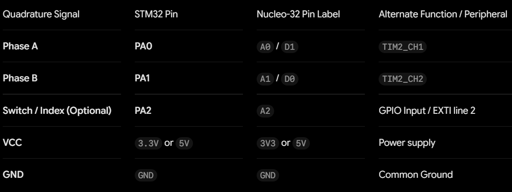

## Resources

For Lab 5, the following resources were available to use:

- [E155 Lab 5 Instructions](https://hmc-e155.github.io/lab/lab5/)
- [E155 Lab 5 Specifications](https://hmc-e155.github.io/lab/lab5/specs.html)
- [E155 C Style & Code Specifications](https://hmc-e155.github.io/lab/specs/c-style-specs.html)
- [E155 Resource for Interrupts Flowchart](https://users.ece.utexas.edu/~valvano/Volume1/E-Book/C12_Interrupts.htm)
- [E155 Lecture - Interrupts](https://hmc-e155.github.io/lecture/)
- [E155 Tutorial Interrupts GitHub](https://github.com/HMC-E155/tutorial-interrupts)
- [E155 Using printf for MCU debugging](https://hmc-e155.github.io/tutorials/tutorial-posts/printf-no-uart/index.html)
- [E155 25GA-370 DC Motor](https://hmc-e155.github.io/assets/lab/25GA370.pdf)
- [MCU Reference Manual](https://hmc-e155.github.io/assets/doc/rm0394-stm32l41xxx42xxx43xxx44xxx45xxx46xxx-advanced-armbased-32bit-mcus-stmicroelectronics.pdf)
- [MCU Datasheet](https://hmc-e155.github.io/assets/doc/ds11451-stm32l432kc.pdf)
- [MCU Programmer Manual](https://hmc-e155.github.io/assets/doc/pm0214-stm32-cortexm4-mcus-and-mpus-programming-manual-stmicroelectronics.pdf) 
- [E155 AI Prototype](https://hmc-e155.github.io/lab/lab5/ai-prototype.html)


## Hardware

The list of components used included: 

- 1x STM32L432KC MCU
- 1x 25GA-370 DC motor (1:34 gear ratio was used)
- 1x quadrature encoder 
- 1x power supply

Resources used for hardware connections included:

- [E155 25GA-370 DC Motor](https://hmc-e155.github.io/assets/lab/25GA370.pdf) 
- [MCU Datasheet](https://hmc-e155.github.io/assets/doc/ds11451-stm32l432kc.pdf)

Calculations for verifying meausured and true motor speed and direction are located in the "Calculations" section. 

## Software
Lab 5 files included "main.c", "main.h", "encoder.c", "encoder.h", and tutorial interrupt files for the STM32L432KC MCU from the E155 course website.

The coding process included first referring to the starter code found in [E155 Tutorial Interrupts GitHub](https://github.com/HMC-E155/tutorial-interrupts) and finding more information in other resources, such as the [MCU Reference Manual](https://hmc-e155.github.io/assets/doc/rm0394-stm32l41xxx42xxx43xxx44xxx45xxx46xxx-advanced-armbased-32bit-mcus-stmicroelectronics.pdf). 

<details>
<summary>Reveal C Code: main.c</summary>
```c
/*********************************************************************
*                    SEGGER Microcontroller GmbH                     *
*                        The Embedded Experts                        *
**********************************************************************

-------------------------- END-OF-HEADER -----------------------------

File    : main.c
Purpose : Generic application start

*/

#include <stdio.h>
#include "STM32L432KC.h" 
#include "stm32l432xx.h" // necessary for printf to work
#include "main.h"  // Houses peripheral macros and custom PA1/PA2 pin labels
#include "encoder.h"+


// From E155 "Using printf for MCU debugging": Function used by printf to send characters to the laptop
int _write(int file, char *ptr, int len) {
  int i = 0;
  for (i = 0; i < len; i++) {
    ITM_SendChar((*ptr++));
  }
  return len;
}


// Initialize global variables
volatile int32_t g_pulse_count = 0;
volatile uint8_t g_time_base_flag = 0;

// A look-up variable for storing the prior physical phase configuration 
static volatile uint8_t s_raw_current_state = 0;


// Handles physical edge changes on motor Channel A (PA1)
void EXTI1_IRQHandler(void) {
    if (EXTI->PR1 & (1 << 1)) {
        EXTI->PR1 = (1 << 1);  // Clear hardware pending flag by writing a 1
        ENCODER_ProcessEdge(); // Execute the 4x Gray Code directional state machine check
    }
}

// Handles physical edge changes on motor Channel B (PA2)
void EXTI2_IRQHandler(void) {
    if (EXTI->PR1 & (1 << 2)) {
        EXTI->PR1 = (1 << 2);  // Clear hardware pending flag by writing a 1
        ENCODER_ProcessEdge(); // Execute the 4x Gray Code directional state machine check
    }
}

// 1 Hz Time Base asynchronous execution handler 
void TIM2_IRQHandler(void) {
    if (TIM2->SR & (1 << 0)) {
        TIM2->SR &= ~(1 << 0); // Clear timer update interrupt status flag
        g_time_base_flag = 1;  // Notify main background loop thread that 1 second has elapsed
    }
}

// ============================================================================
// Main Application Entry Point
// ============================================================================
int main(void) {
    // Ensure flash latency configurations match the 80 MHz processing speed
    configureFlash(); 

    // Use custom class library to scale clock speed from 4MHz to 80 MHz safely
    configureClock(); 
    //SystemCoreClockUpdate();
    
    // Initialize standalone peripheral driver blocks 
    ENCODER_Init();          // Configures pins, pull-ups, and unmasks EXTI lines
    ENCODER_StartTimeBase(); // Configures and runs the 1 Hz TIM2 interrupt clock
    
    // Enable system interrupts globally
    __enable_irq(); 
    
    printf("--- SEGGER Architecture Online (80 MHz Core Initialized) ---\n");
    printf("Tracking calibrated for a Motor over a 1 Hz reporting window.\n");
    
    while (1) {
        // Check if the 1 Hz timer flag has fired asynchronously
        if (g_time_base_flag == 1) {
            g_time_base_flag = 0; // Clear software notification flag instantly
            
             // Take a snapshot of the pulse accumulations 
            volatile int32_t delta_pulses = ENCODER_GetAndResetDelta();
            
            // Defend against accidental division-by-zero configuration runtime traps
            if (ENCODER_TOTAL_PPR <= 0.0f) {
                printf("ERROR: Quadrature scaling macro unconfigured.\n");
                continue;
            }
            
            // Calculate velocity in revolutions per second over our fixed delta_t = 1.0 s window
            float velocity_rev_s = (float)delta_pulses / 285; // ENCODER_TOTAL_PPR; 285 = the value of the delta_pulses when initially had vel = delta_pulses/ENCODER_TOTAL_PPR 

            // Print strings to show velocity and direction of the motor spinning or not 
            if (delta_pulses > 0) {
                printf("DIR: CW  | v: %6.3f rev/s | delta_pulses: %d \n", velocity_rev_s, delta_pulses); 
            } else if (delta_pulses < 0) {
                // Format backward paths as absolute positive values accompanied by CCW flag
                printf("DIR: CCW | v: %6.3f rev/s | | delta_pulses: %d \n", -velocity_rev_s, delta_pulses);
            } else {
                // Reports exactly 0.000 when stopped
                printf("DIR: STOP| v:  0.000 rev/s\n");
            }
        }
        
    }
}


/*************************** End of file ****************************/
```
</details>

<details>
<summary>Reveal C Code: main.h</summary>
```c
#ifndef MAIN_H
#define MAIN_H

#include "STM32L432KC.h"
#include <stm32l432xx.h>

// Standard board components from interrupts tutorial starter code
#define LED_PIN             PB3
#define BUTTON_PIN          PA7
#define DELAY_TIM           TIM2

// Reusable 5V-Tolerant Input pin pairs mapping to EXTI1 and EXTI2 respectively
#define ENCODER_PIN_CH1     PA1  
#define ENCODER_PIN_CH2     PA2  

#endif // MAIN_H
```
</details>

<details>
<summary>Reveal C Code: encoder.c</summary>
```c
// encoder.c
// Source code for ENCODER functions

#include "encoder.h"
#include "main.h"  // Ensures abstract pin tracking maps safely

// Prior physical phase look-up state machine variable
static volatile uint8_t s_raw_current_state = 0;

// Step 4: Configure the Multi-interrupt matrix (EXTI and NVIC)
void ENCODER_Init(void) {
    // Step 1: Initialize Port A clock using tutorial driver function
    gpioEnable(GPIO_PORT_A);
    
    // Step 1: Configure 5V-Tolerant tracks PA1 and PA2 pins as inputs
    pinMode(ENCODER_PIN_CH1, GPIO_INPUT);
    pinMode(ENCODER_PIN_CH2, GPIO_INPUT);
    
    // Step 3: Enable internal pull-ups to cleanly pull open-drain sensors up to 3.3V 
    //pinResistor(ENCODER_PIN_CH1, GPIO_PULL_UP);
    //pinResistor(ENCODER_PIN_CH2, GPIO_PULL_UP);
    // Clear the PUPDR bits for PA1 and PA2 first (0b11 clears two bits)
    GPIOA->PUPDR &= ~(0b11 << (2 * gpioPinOffset(ENCODER_PIN_CH1)));
    GPIOA->PUPDR &= ~(0b11 << (2 * gpioPinOffset(ENCODER_PIN_CH2)));

    // Now safely set them as Pull-Up (0b01) using tutorial button_interrupt.c
    GPIOA->PUPDR |= (0b01 << (2 * gpioPinOffset(ENCODER_PIN_CH1))); // Set PA1 pull-up
    GPIOA->PUPDR |= (0b01 << (2 * gpioPinOffset(ENCODER_PIN_CH2))); // Set PA2 pull-up
    
    // Step 4: Route physical PA1 & PA2 lines into EXTI hardware channels 
    RCC->APB2ENR |= RCC_APB2ENR_SYSCFGEN; 
    
    // Clear EXTI multiplexer fields for lines 1 and 2 to explicitly bind them to Port A
    SYSCFG->EXTICR[0] &= ~(SYSCFG_EXTICR1_EXTI1 | SYSCFG_EXTICR1_EXTI2);

    // Get zero-indexed pin offsets from the tutorial framework
    int offset_ch1 = gpioPinOffset(ENCODER_PIN_CH1); // PA1 -> 1
    int offset_ch2 = gpioPinOffset(ENCODER_PIN_CH2); // PA2 -> 2

    // Step 4: Unmask lines and bind BOTH Rising & Falling triggers (Excellence 4x Decoding)
    EXTI->IMR1  |= (1 << offset_ch1) | (1 << offset_ch2);   // Unmask EXTI lines 1 and 2
    EXTI->RTSR1 |= (1 << offset_ch1) | (1 << offset_ch2);   // Enable Rising Edge Triggers
    EXTI->FTSR1 |= (1 << offset_ch1) | (1 << offset_ch2);   // Enable Falling Edge Triggers

    // Prime the lookup state variable with the current pin arrangement
    s_raw_current_state = ((uint8_t)digitalRead(ENCODER_PIN_CH1) << 1) | (uint8_t)digitalRead(ENCODER_PIN_CH2);

    // Enable individual peripheral exception channels inside the core NVIC ISER
    NVIC->ISER[0] |= (1 << EXTI1_IRQn); 
    NVIC->ISER[0] |= (1 << EXTI2_IRQn);
}

// Step 6: TIM2 Timebase Initialization Pipeline 
void ENCODER_StartTimeBase(void) {
    // Enable TIM2 Core Clock line (TIM2 lives on APB1ENR1 bus, not APB2)
    RCC->APB1ENR1 |= RCC_APB1ENR1_TIM2EN;
    
    // Deploy hardware TIM2 using initTIM() from your class tutorial library
    initTIM(TIM2); 
    
    // Step 6: initTIM builds a steady 1 ms clock base. 
    // Set ARR to 1000 - 1 = 999 to cycle exactly every 1000 ms (1.0 Second / 1 Hz window) 
    TIM2->ARR = 1000 - 1;
    
    // Synchronize peripheral registers and clear initial update flag 
    TIM2->EGR |= TIM_EGR_UG;
    TIM2->SR &= ~TIM_SR_UIF;
    
    // Step 6: Unmask the TIM2 Update Interrupt channel 
    TIM2->DIER |= TIM_DIER_UIE;
    
    // Turn on TIM2 interrupt handling inside the core NVIC ISER register block
    NVIC->ISER[0] |= (1 << TIM2_IRQn);
}

// Read-and-clear utility prevents pulse-dropping bugs
int32_t ENCODER_GetAndResetDelta(void) {
    __disable_irq(); // Enter critical section
    volatile int32_t delta = g_pulse_count;
    g_pulse_count = 0;
    __enable_irq();  // Exit critical section
    return delta;
}

/**
 * Step 5: Core phase decoding layer 
 * Uses both edges of both channels to compute accurate direction and speed.
 */
void ENCODER_ProcessEdge(void) {
    uint8_t previous_state = s_raw_current_state;
    
    // Fast 2-bit state read using the class GPIO helper functions
    uint8_t pin_a = (uint8_t)digitalRead(ENCODER_PIN_CH1);
    uint8_t pin_b = (uint8_t)digitalRead(ENCODER_PIN_CH2);
    uint8_t current_state = (pin_a << 1) | pin_b;
    s_raw_current_state = current_state;
    
    // Quadrature Look-up Translation Matrix
    if ((previous_state == 0b00 && current_state == 0b01) || 
        (previous_state == 0b01 && current_state == 0b11) ||
        (previous_state == 0b11 && current_state == 0b10) || 
        (previous_state == 0b10 && current_state == 0b00)) {
        g_pulse_count++; // Clockwise (CW) Rotation Step (positive direction)
    } else if (previous_state != current_state) {
        g_pulse_count--; // Counter-Clockwise (CCW) Rotation Step (negative direction)
    }
}
```
</details>

<details>
<summary>Reveal C Code: encoder.h</summary>
```c
// encoder.h
// Header for ENCODER functions

#ifndef ENCODER_H
#define ENCODER_H

#include <stdint.h>

// Include platform peripheral libraries
#include "STM32L432KC_GPIO.h"
#include "STM32L432KC_RCC.h"
#include "STM32L432KC_TIM.h"

// ============================================================================
// Step 7: Motor-Specific Calibration Target Constants
// ============================================================================
// 4x Quadrature decoding uses both edges (falling and rising) of both channels.
// From E155 Lab 5 instructions, a 25GA-3700H-34 motor (DC: 12V, 150 RPM) with a gear ratio 1:34 has a 408 pulse per rotation, should rotate ~2.5 rev/s at 12V
#define ENCODER_TOTAL_PPR  408.0f  

// ============================================================================
// Step 5 & 7: Shared Global Variables 
// ============================================================================
extern volatile int32_t g_pulse_count; 
extern volatile uint8_t g_time_base_flag;

// ============================================================================
// Public ENCODER Subsystem Shared Function Prototypes
// ============================================================================
/**
 * Initializes GPIO pins PA1 and PA2 as inputs, enables pull-ups, 
 *         routes them to EXTI1 and EXTI2, and unmasks 4x edge triggers.
 */
void ENCODER_Init(void);

/**
 * Configures the TIM2 peripheral using the tutorial's initTIM function 
 *         to generate a recurring 1 Hz interrupt update flag.
 */
void ENCODER_StartTimeBase(void);

/**
 * Safely extracts the accumulated pulse count 
 *         and resets it within a critical section to guarantee no pulses are missed.
 * The accumulated signed 32-bit delta pulse count.
 */
int32_t ENCODER_GetAndResetDelta(void);

/**
 * Processes pin changes on PA1 and PA2 
 *         using a state machine lookup matrix to track true velocity and direction.
 */
void ENCODER_ProcessEdge(void);

#endif 
```
</details>


## Calculations

Raw Encoder Pulses and Timing for Conversion into Velocity: 

1. In the ENCODER_ProcessEdge function in "encoder.c", there is a background pulse counter variable named "g_pulse_count". This variable increments on every detected forward edge ("g_pulse_count++") and decrements on every reverse edge ("g_pulse_count--"). 
2. To calculate velocity without timing drift, a hardware timer (TIM2) isolates a precise snapshot window of length $\Delta$t. 
3. The velocity v in revolutoins per second (rev/s) is calculated using the formula $Velocity (rev/s) = \frac{\Delta Pulses}{Total PPR \times \Delta t}$. $\Delta Pulses$ is calculated in the ENCODER_GetAndResetDelta function "encoder.c" using the formula $\Delta Pulses = Current Count - Previous Count$. As given in the [E155 Lab 5 Instructions](https://hmc-e155.github.io/lab/lab5/), total PPR is 408 pulse per rotation. 
4. In this case, let $\Delta$t = 1.0 s to be the precise time base window managed by the timer interrupt. This is because TIM2 is clocked by the 80 MHz APB1 peripherical clock (SYSCLK = 80 MHz). With PSC = 7999 and ARR = 9999, $f_{tick} = \frac{80,000,000 Hz}{7999 + 1} = 10,000 Hz$ with $T_{tick} = 0.1 ms$. So, $\Delta t = (9999 + 1) \times 0.1 ms = 10,000 \times 0.0001 s = 1 s$. 
5. In "main.c", the velocity equation is computed as delta_pulses divided by 285, where 285 was the output value for "delta_pulses" printed in the software's debug terminal when the velocity was initially computed as "delta_pulses" divided by the PPR. A division of "delta_pulses" in the numerator and denominator such that velocity of 1 rev/s is hardcoded in "main.c" was used to normalize the output to 1 at that operating point rather than fixing the underlying timer issues.  


Verification for Measured vs. True Motor Velocity:

1. At 12V, the rated speed for the 150 RPM motor is $Rated Speed = 150 RPM = \frac{150 rev}{60 s}$ = 2.50 rev/s. 
2. At 12V and 1A on the power supply, the measured speed was approximately 3.00 rev/s. This is within reasonable range because the 150 RPM at 12V is a rated load speed whereas a no-load condition can result in the unloaded DC motor to operate faster than the rated load speed. In this case, it is shown as operating 20% faster: $Percent Difference = \frac{3.00 - 2.50}{2.50} \times 100 \% = + 20.0 \%$. 
3. In terms of raw encoder pulses per second (PPR = 408 pulses/rev), the expected loaded pulses per second is  2.50 rev/s $\times$ 408 pulses/rev = 1020 pulses/s. The measured unloaded pulses per scecond is $\approx$ 3.00 rev/s $\times$ 408 pulses/rev = 1224 pulses/s. 

Raw Encoder Pulses and Timing for Conversion into Direction and Verification for Measured vs. True Motor Direction: 

1. The system uses 4x Quadrature Decoding, which tracks both the rising and falling edges of both Channel A (PA1) and Channel B (PA2).
2. Because the physical Hall effect sensors are placed 90 deg out of phase, the direction is determined by analyzing which motor channel "leads" the other.
3. In this case, the forward (clockwise) direction is defined as when Channel A changes state before Channel B. In other words, the encoder's internal Hall effect sensors are generating square waves where Channel A leads Channel B by 90 degrees. For example, if the previous combined state was 0b00 and it changes state to 0b01, 0b11, 0b10, and then 0b00, then the motor is turning forward. Each transition increments "g_pulse_count", which then produces "delta_pulses > 0" and printing "CW" in the debug terminal. Hardware wise, this is when the positive terminals between power supply and motor are attached while the negative terminals are similarly attached to one another. Measured and true motor direction demonstrated the behavior of outputting non-zero velocity with a "CW" direction when the motor was spinning in the forward direction.
4. On the other hand, the reverse (counter-clockwise) direction is defined as when Channel B changes state before Channel A. In other words, the encoder's internal Hall effect sensors are generating square waves where Channel B leads Channel A by 90 degrees. Phase transitions follow the opposite pattern (0b00 to 0b10, 0b11, 0b01, and then 0b00), meaning the motor is turning in reverse. Each transition decrements "g_pulse_count", which then produces "delta_pulses < 0" and printing "CCW" in the debug terminal. Hardware wise, this is when the positive terminal of the power supply is to the motor's negative terminal, and the negative terminal of the power supply is to the motor's positive terminal. Measured and true motor direction demonstrated the behavior of outputting non-zero velocity with a "CCW" direction when the motor was spinning in the reverse direction.
5. At 0V or when the motor is not spinning, no edges would fire EXTI1 or EXTI2. This then gives "delta_pulses" as 0, printing the direction as "STOP", and velocity as zero revolutions per second. Measured and true motor direction demonstrated the behavior of outputting zero velocity with a "STOP" direction when the motor was stationary. 


Verification: Update Rate Achieved

- To prove that an update rate of at least 1 Hz is achieved, calcuations for showing how the clock configuration sets the hardware timer parameters was performed. 

1. Based on the configurePLL function in "STM32L432KC_RCC.c" starter code, the system clock source $f_{cyc}$ is equal to 80 MHz. 
2. Based on the initTim function in "STM32L432KC_TIM.c" starter code, the code dynamically scales the timer prescaler (PSC) to establish a 1 ms tick resolution using $PSC = \frac{f_{cyc}}{1 kHz} - 1 = \frac{80,000,000 Hz}{1,000 Hz} - 1 = 7999$. TIM2 was the chosen timer for this lab and implemented in the ENCODER_StartTimeBase function in "encoder.c" via the line "initTIM(TIM2)". 
3. To generate a 1-second update window or to cycle exactly every 1000 ms (1 second / 1 Hz window), the auto-reload period (ARR) can be used such that the timer counts up to 1000 ms using the formula $ARR = 1000 - 1 = 999$.  
4. To mathematically verify the update rate of exactly 1 Hz, the update frequency equation can be used: $f_{update} = \frac{f_{cyc}}{(PSC + 1) \times (ARR + 1)} = \frac{80,000,000 Hz}{8,000 \times 1,000} = 1.0 Hz$. 


Verification: Resolution Achieved

- The resolution of the system is the smallest change in motor speed that the microcontroller can physically detect. Because the timer window is fixed to 1 second, the smallest change in count over that window is 1 pulse ($\Delta Pulses = 1$). 
- The velocity resolution equation that can then be used is: $Velocity Resolution = \frac{\Delta Pulses}{Total PPR \times \Delta t} = \frac{1}{408 \times 1.0 s} \approx 0.00245 rev/s$. 
- Based on this result, it means that the system can capture approximately 4 pulses per second at the ultra-slow motor speed of 0.01 rev/s because of the implemented 4x quadrature decoding and 1.0-second integration window. Since the resolution of 0.00245 rev/s is much finer than the slowest speed 0.01 rev/s, the system can output a stable, continuous, non-zero reading at very low speeds and capture the edges of both the motor channels (4x resolution). 

## Schematic

Resources used for pins and connections between the MCU, quadrature encoder, and a DC motor:

- [E155 25GA-370 DC Motor](https://hmc-e155.github.io/assets/lab/25GA370.pdf)
- [MCU Datasheet](https://hmc-e155.github.io/assets/doc/ds11451-stm32l432kc.pdf)

Recall that the encoder operates at a 5V logic level while the MCU (STM32L432KC) uses 3.3V. This then means that 5V tolerant pins should be used and can be found in Tables 13-14 in the MCU datasheet. 


<details>
<summary>Lab 5 Schematic: Motor</summary>

[View PDF](images/e155_lab5_schematics.pdf)

</details>


## Conclusion
Number of hours spent working on the lab: at least 20 hours

By the end of the hours worked, the design requirements were met to a certain extent. Improvements that can be made include addressing timing issues and any other underlying issues for the velocity. Learning challenges along the way included trying to understand interrupts in general, how to get the printf working, and how to get a velocity that seems reasonable. 

## AI Prototype
LLM Prompt: "Write me interrupt handlers to interface with a quadrature encoder. I’m using the STM32L432KC, what pins should I connect the encoder to in order to allow it to easily trigger the interrupts?"

The AI-generated output included explaning that manual EXTI GPIO interrupt handlers should not be written because it will cause "missed steps, high CPU load, and race conditions at higher rotational speeds". It then suggested to use the STM32's built-in Hardware Timer Encoder Interface (TIM1 or TIM2) because it is a dedicated peripheral for tracking quadrature phase shifts, decoding directional rotation, and updating a hardware counter register automatically in the background without incurring CPU overload. The recommended pin connections was then shown as a table. It also added a note that internal pull-up resistors should be configured if the encoder outputs are open-collector / open-drain. 

<details>
<summary>AI-generated Table of Recommended Pin Connections</summary>



</details>

When trying to run the AI-generated code as it was given, it did not run because of errors regarding unknown files such as "stm32l4xx_hal.h", but also unknown lines such as "__GAL_RCC_TIM2_CLK_ENABLE()" and "GPIO_InitTypeDef". I then tried using  the LLM (Google Gemini) to debug the issue by asking how to address the specific errors. The output from the follow-up debugging prompt mentioned what to do if the project is using STM32CubeMX or STM32CubeIDE because the "stm32l4xx_hal.h" file is located within the STM32Cube firmware package. This then made me realized that the AI-generated output was using a different MCU even though the original prompt specified that a STM32L432KC was used. Other suggested fixes was to verify the include paths in the IDE because if the IDE compiler does not now where the driver header files are stored, then the code cannot run properly. This means that assumptions were made when generating the code.  

I would then rate the quality of the output as 4/10 because it considered using a timer, such as TIM2, but made too many assumptions from misinterpreting what type of MCU was being used. I believe that the LLM (Google Gemini) does not necessarily work well as a sounding board because despite specifying what MCU I was using, it did not use that MCU for its code. I would then not completely trust how logical it is when answering the given prompt. 

<details>
<summary> AI-generated Results for Prompt</summary>
```c
//=====Configuration and Initialization Code=====
#include "stm32l4xx_hal.h" 

TIM_HandleTypeDef htim2;

void Encoder_Init(void) {
    __HAL_RCC_GPIOA_CLK_ENABLE();
    __HAL_RCC_TIM2_CLK_ENABLE();

    // 1. Configure GPIO Pins (PA0 and PA1) for TIM2 Alternate Function
    GPIO_InitTypeDef GPIO_InitStruct = {0};
    GPIO_InitStruct.Pin = GPIO_PIN_0 | GPIO_PIN_1;
    GPIO_InitStruct.Mode = GPIO_MODE_AF_PP;
    GPIO_InitStruct.Pull = GPIO_PULLUP; // Set to GPIO_PULLUP or GPIO_NOPULL depending on hardware
    GPIO_InitStruct.Speed = GPIO_SPEED_FREQ_HIGH;
    GPIO_InitStruct.Alternate = GPIO_AF1_TIM2;
    HAL_GPIO_Init(GPIOA, &GPIO_InitStruct);

    // 2. Configure TIM2 for Encoder Mode (4x Resolution: T1 and T2)
    htim2.Instance = TIM2;
    htim2.Init.Prescaler = 0;
    htim2.Init.CounterMode = TIM_COUNTERMODE_UP;
    htim2.Init.Period = 0xFFFF; // 16-bit or 32-bit wrap limit
    htim2.Init.ClockDivision = TIM_CLOCKDIVISION_DIV1;
    htim2.Init.AutoReloadPreload = TIM_AUTORELOAD_PRELOAD_ENABLE;

    TIM_Encoder_InitTypeDef encoderConfig = {0};
    encoderConfig.EncoderMode = TIM_ENCODERMODE_TI12; // Counts both edges on CH1 and CH2
    
    // Channel 1 setup
    encoderConfig.IC1Polarity = TIM_ICPOLARITY_RISING;
    encoderConfig.IC1Selection = TIM_ICSELECTION_DIRECTTI;
    encoderConfig.IC1Prescaler = TIM_ICPSC_DIV1;
    encoderConfig.IC1Filter = 6; // Filter (0-15) to eliminate mechanical contact bounce
    
    // Channel 2 setup
    encoderConfig.IC2Polarity = TIM_ICPOLARITY_RISING;
    encoderConfig.IC2Selection = TIM_ICSELECTION_DIRECTTI;
    encoderConfig.IC2Prescaler = TIM_ICPSC_DIV1;
    encoderConfig.IC2Filter = 6;

    HAL_TIM_Encoder_Init(&htim2, &encoderConfig);
    HAL_TIM_Encoder_Start(&htim2, TIM_CHANNEL_ALL);
}

//=====Reading the Position & Direction=====
int32_t Encoder_GetPosition(void) {
    return (int32_t)__HAL_TIM_GET_COUNTER(&htim2);
}

// Check direction: 0 = Counting UP (Forward), 1 = Counting DOWN (Reverse)
uint8_t Encoder_GetDirection(void) {
    return __HAL_TIM_IS_TIM_COUNTING_DOWN(&htim2);
}

//=====Optional: Push-Button Interrupt Handler (EXTI)=====
void Switch_Init(void) {
    __HAL_RCC_GPIOA_CLK_ENABLE();

    GPIO_InitTypeDef GPIO_InitStruct = {0};
    GPIO_InitStruct.Pin = GPIO_PIN_2;
    GPIO_InitStruct.Mode = GPIO_MODE_IT_FALLING; // Active LOW push-button
    GPIO_InitStruct.Pull = GPIO_PULLUP;
    HAL_GPIO_Init(GPIOA, &GPIO_InitStruct);

    // Enable EXTI Line 2 Interrupt
    HAL_NVIC_SetPriority(EXTI2_IRQn, 2, 0);
    HAL_NVIC_EnableIRQ(EXTI2_IRQn);
}

// Vector Table IRQ Handler
void EXTI2_IRQHandler(void) {
    HAL_GPIO_EXTI_IRQHandler(GPIO_PIN_2);
}

// HAL Callback when switch is pressed
void HAL_GPIO_EXTI_Callback(uint16_t GPIO_Pin) {
    if (GPIO_Pin == GPIO_PIN_2) {
        // Reset encoder position on button press
        __HAL_TIM_SET_COUNTER(&htim2, 0);
    }
}
```
</details>